<div align="center">

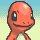
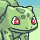
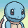

# Pokémon Survivors

**A free Vampire Survivors–style roguelite with Pokémon, playable in the browser.**

Pick one of 27 starters, survive 15 minutes of wild hordes, learn moves, evolve, and take down Mewtwo.

[**▶ Play at pokemonsurvivors.com**](https://www.pokemonsurvivors.com)

[](https://github.com/pedrobarretto/pokemon-survivors/actions/workflows/ci.yml)
[](LICENSE)
[](#legal)

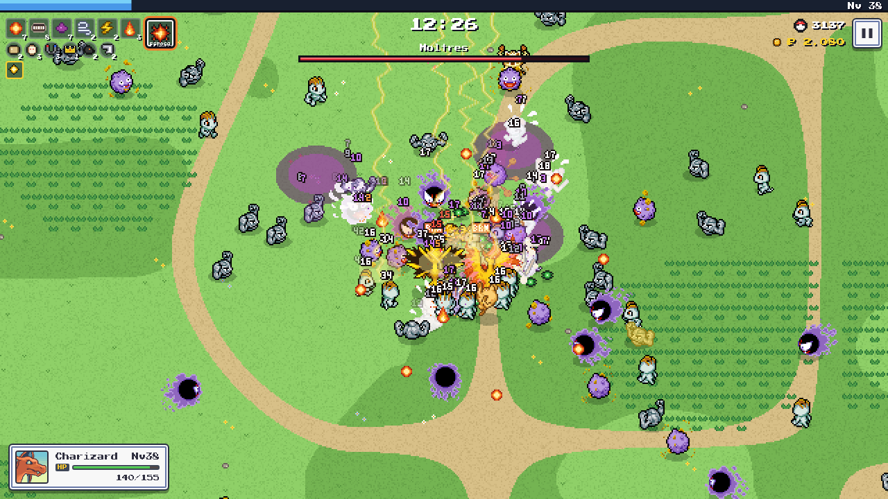

</div>

> [!NOTE]
> Pokémon Survivors is an unofficial, non-commercial fan game. It is **not affiliated with, endorsed, sponsored or approved by** Nintendo, The Pokémon Company, GAME FREAK or Creatures. See [Legal](#legal).

The game is in Brazilian Portuguese 🇧🇷 and English 🇺🇸, picked from your browser language and switchable from the menus. Pokémon, move and item names use their official English names.

## Screenshots

<table>
  <tr>
    <td width="50%">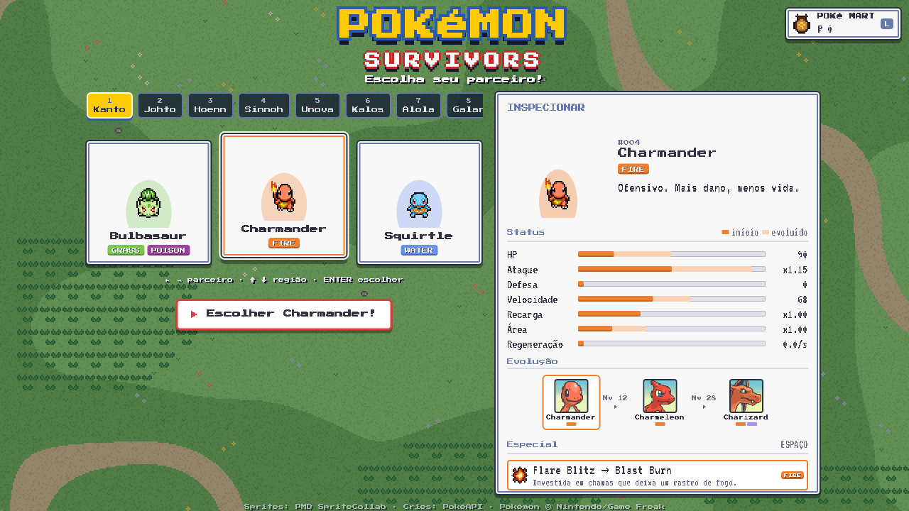</td>
    <td width="50%">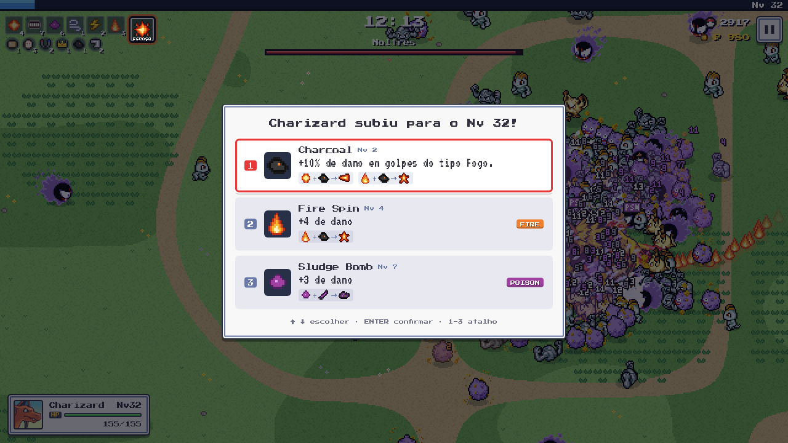</td>
  </tr>
  <tr>
    <td align="center"><sub>Pick a starter from any region and inspect its stats, evolutions and moves</sub></td>
    <td align="center"><sub>Level up and build your moveset with held items</sub></td>
  </tr>
  <tr>
    <td>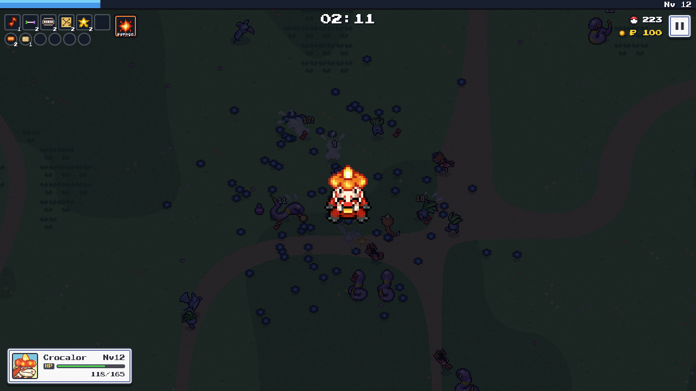</td>
    <td>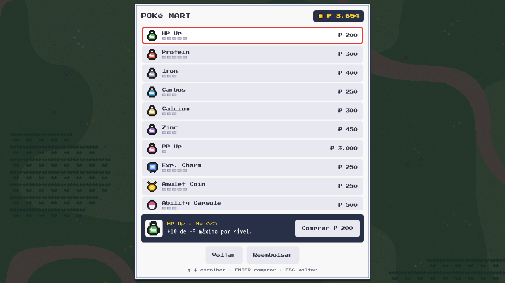</td>
  </tr>
  <tr>
    <td align="center"><sub>Evolve mid-run, just like on the handhelds</sub></td>
    <td align="center"><sub>Spend Poké Dollars on permanent upgrades</sub></td>
  </tr>
</table>

<p align="center">
  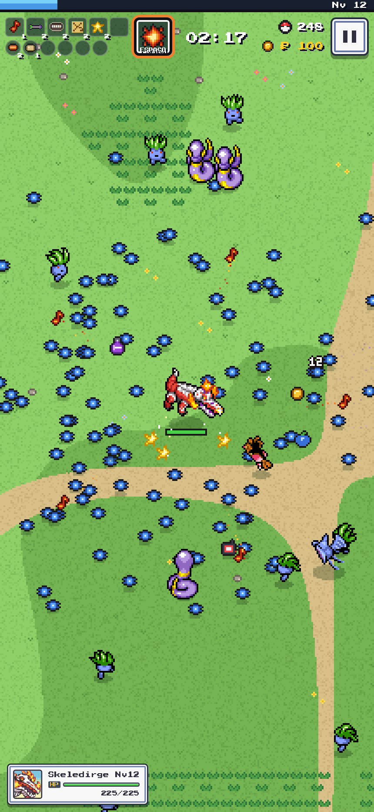<br>
  <sub>Works on phones too: floating joystick, touch special button, installable as a fullscreen app</sub>
</p>

## Features

- **27 starters from every region**, each with a full 3-stage evolution line, its own stats, signature move and learnset.

  <table>
    <tr><th>Kanto</th><th>Johto</th><th>Hoenn</th><th>Sinnoh</th><th>Unova</th><th>Kalos</th><th>Alola</th><th>Galar</th><th>Paldea</th></tr>
    <tr>
      <td></td>
      <td>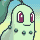</td>
      <td>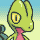</td>
      <td>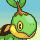</td>
      <td>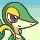</td>
      <td>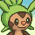</td>
      <td>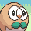</td>
      <td>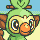</td>
      <td>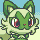</td>
    </tr>
    <tr>
      <td></td>
      <td>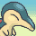</td>
      <td>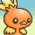</td>
      <td>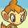</td>
      <td>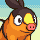</td>
      <td>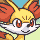</td>
      <td>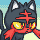</td>
      <td>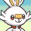</td>
      <td></td>
    </tr>
    <tr>
      <td></td>
      <td>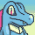</td>
      <td>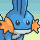</td>
      <td>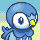</td>
      <td></td>
      <td>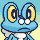</td>
      <td>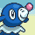</td>
      <td>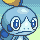</td>
      <td></td>
    </tr>
  </table>

- **23 moves and 19 held items.** Max out a move, pair it with the right item, and it evolves (Ember + Charcoal → Flamethrower).
- **Real type matchups**, burn, poison and paralysis, and a manual **special attack** per type that becomes Blast Burn, Hydro Cannon or Frenzy Plant at the final evolution.
- **Bosses with telegraphed attack patterns**: Onix, Snorlax, the legendary birds and Mewtwo. Mew sometimes shows up.

  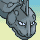 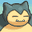 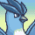  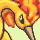 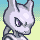 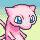

- **Shinies**: any wild Pokémon can be a shiny elite (1/450), and your starter has a 1/64 chance to be shiny for the whole run.
- **Five biomes per run**: Route 1, Viridian Forest, Mt. Moon, Mt. Silver and Lavender Tower, each with its own ground, breakables and theme, cross-dissolving with no loading screen.
- **Weather** for everyone: harsh sunlight (Fire ×1.5, Water ×0.75), rain (the opposite), sandstorm and snow (wear down non-immune types) and fog (short sight).
- **Items on the map**: break item balls, berry trees and tall grass for Potions, Rare Candies, Max Repels, a Voltorb that explodes, and more.
- **Meta progression**: collect Poké Dollars and spend them in the Poké Mart on permanent upgrades (HP Up, Protein, Exp. Charm…).
- **Original chiptune soundtrack**, synthesized live in WebAudio (no audio files): a village theme in the menus, one theme per biome, and a boss theme while a boss is alive.
- **Settings**: music and effects volume, damage numbers, screen shake and language, saved in the browser.
- **Pixel-perfect**: the world renders at about 300px tall and is integer-upscaled, so sprites, effects and particles share one pixel grid.

## Controls

| | Keyboard / gamepad | Touch |
| --- | --- | --- |
| Move | WASD / arrows | Drag anywhere (floating joystick) |
| Special attack | `Space` / A (✕) | Round button, bottom right |
| Pause | `Esc` / `P` / Start | Pause button, top right |
| Pick an upgrade | `1`–`3` | Tap it |
| Mute | `M` | Settings, on the title screen or in the pause menu |
| Menus | Arrows / D-pad, `Enter` / A, `Esc` / B back | Tap |
| Switch language | `I` (title screen) or Settings | `PT \| EN`, top left of the title screen, or Settings |

On a gamepad, the D-pad and left stick drive every menu. In a run, A fires the special and Start pauses, but the gamepad can't move your Pokémon yet: use the keyboard or touch.

## Running locally

Requires Node.js 22+.

```bash
npm install
npm run dev        # http://localhost:5173
npm test           # focused rules tests (vitest)
npm run build      # typecheck + production build
npm run assets     # re-download sprites/cries (already committed in public/)
npm run credits    # regenerate CREDITS.md from SpriteCollab
```

In dev builds the browser console exposes `ps.run()` (current run state), `ps.startRun('squirtle')`, `ps.theme()` (music theme playing), `ps.biome('cave')` and `ps.weather('rain')`.

## How it's built

Vite + TypeScript and Canvas 2D, with no game engine. Everything is plain data plus functions (no classes). The UI is DOM with pixel fonts (Press Start 2P / VT323).

```
src/
  engine/   math, seeded rng, spatial hash, input, WebAudio sfx and music synth, pixel-art helpers
  data/     pure game data: starters, enemies, waves, biomes, weather, held items, move evolutions, type chart, music scores
  game/     simulation (fixed 60 Hz tick): game.ts orchestrates the systems
            moves.ts (weapons) · attacks.ts (hitboxes) · enemies.ts · spawner.ts
            combat.ts · pickups.ts · leveling.ts · effects.ts · special.ts (manual special attack)
            status.ts (pure condition rules) · statusSystem.ts (DoT ticks, particles)
            consumables.ts (floor items, buffs) · props.ts (breakable item sources)
            bosses.ts (boss attack patterns, enemy hazards) · shiny.ts · biomes.ts · weather.ts
  render/   PMD sprite loader, code-drawn pixel art, procedural biome ground, weather overlays, title scene and logo, frame renderer
  ui/       title screen, HUD, starter select, level-up, pause, settings, results, toasts, language switch
  i18n/     every player-facing string: pt.ts (reference) and en.ts; site/ has the website copy
  site/     static pages rendered at build time from data/: Pokédex, guide, changelog, legal
```

<details>
<summary><b>Architecture notes</b></summary>

- **Simulation and presentation are decoupled.** `step(game, input, dt)` mutates the state and pushes `GameEvent`s. `main.ts` drains them each frame to play sounds and cries and show toasts.
- **Moves** are data plus a `fire(game, stats)` function. Upgrades are stat deltas. Player modifiers (might, area, cooldown…) are applied in `moveStats`. Each hitbox is a generic `Attack` with a `motion` (linear, homing, orbit, boomerang, follow, static) and a `visual`.
- **Waves** live in `data/waves.ts`: spawn stages by time, plus events (flyby swarms, closing rings, bosses, optionally rare via `chance`).
- **Bosses** attack with data-driven patterns from `data/bosses.ts` (telegraphed `strikes`, projectile `ring`s, lingering `trail`s). They spawn `Hazard`s, which hurt the player. To add a legendary, add it to `ENEMIES` (`legendary: true`), add a boss event and its patterns, and add its dex to `scripts/dex.mjs`.
- **Shinies:** each regular spawn has a 1/450 chance to be a shiny elite (8x HP, 10x EXP, drops a Poké Ball). Shiny sprites come from SpriteCollab's `0000/0001` form, stored in `public/assets/pokemon/<dex>/shiny/`.
- **Status conditions:** moves declare `status: { kind, chance, duration, power }` in data (burn, poison, paralysis, slow; the Poké Flute inflicts sleep). Burn and poison deal damage over time, burn halves contact damage, poison stacks up to 5x, paralysis stuns and stutters (shorter on bosses).
- **Special attack:** one manual move on a cooldown, defined in `special.ts` per Pokémon type (with optional per-species overrides). Input reaches `step()` as data (`{ move, special }`).
- **Languages:** Brazilian Portuguese and English, picked from the browser language and switchable on the title screen (`PT | EN`, or `I`) and in Settings (pause menu). Text lives in `src/i18n`: `pt.ts` is the reference and its inferred type forces `en.ts` to match it, down to one line per move upgrade. Data files keep only the official English names. Toast strings use light markup (`*bold*`, `_accent_`) so each language can put names where its grammar wants them.
- **Type chart:** damage uses real Pokémon type matchups, softened (2x → 1.5x, 0x → 0.5x). Yellow numbers with `!` mean super effective.
- **Music** is code: `data/music.ts` holds the scores in a small tracker notation (`engine/score.ts`) and `engine/music.ts` plays them on two pulse channels, a triangle bass and a noise kit. The shell picks the theme each frame (`playTheme`). Music and effects have separate buses in `engine/audio.ts`, so music always sits under effects and cries.
- **Biomes and weather:** `data/biomes.ts` holds the biome order (equal slices of the run), each biome's weather odds, theme and `affinity` (the types that feel at home there, meant to weight the enemy draw). `game/biomes.ts` follows the schedule and `game/weather.ts` rolls weather spells and applies their rules (`data/weather.ts`): `weatherBoost`/`weatherPower` multiply damage by attack type in `combat.ts` (player moves, enemy bodies by their types, boss hazards by `HAZARD_TYPES`), and sandstorm/snow wear down anyone not immune. The ground and breakables are drawn per biome in `render/world.ts` and `render/props.ts`, the overlays in `render/weather.ts`.
- **Meta progression** is saved in `localStorage`. `game/meta.ts` holds the pure rules.

</details>

## Roadmap

- Evolutions for the newer signature moves (Mach Punch, Spirit Shackle, Pyro Ball…).
- Custom effects/tiles.

## Contributing

Bug reports and ideas are very welcome: [open an issue](https://github.com/pedrobarretto/pokemon-survivors/issues/new/choose). Pull requests are welcome too. Please read [CONTRIBUTING.md](CONTRIBUTING.md) first and follow the [Code of Conduct](CODE_OF_CONDUCT.md).

## Credits

- **Sprites and portraits:** [PMD SpriteCollab](https://sprites.pmdcollab.org) (CC BY-NC 4.0). Every artist is listed in [CREDITS.md](CREDITS.md).
- **Cries:** [PokéAPI/cries](https://github.com/PokeAPI/cries).
- **Fonts:** Press Start 2P and VT323 (SIL Open Font License).
- **Inspiration:** [Vampire Survivors](https://poncle.itch.io/vampire-survivors) by poncle.

## Legal

Pokémon Survivors is an unofficial, free, non-commercial fan project made by fans for fans. It is not affiliated with, endorsed, sponsored or approved by Nintendo, The Pokémon Company, GAME FREAK inc., Creatures Inc. or Spike Chunsoft.

Pokémon and Pokémon character names are trademarks of Nintendo. Pokémon © Nintendo, Creatures Inc. and GAME FREAK inc. All other trademarks belong to their respective owners. The game has no ads, no paid content and no in-app purchases. Poké Dollars exist only inside the game.

The [MIT license](LICENSE) covers only the original source code of this repository. It grants no rights to Pokémon characters, names, sounds or artwork. The sprites and portraits are distributed under [CC BY-NC 4.0](https://creativecommons.org/licenses/by-nc/4.0/), so the game as a whole cannot be used commercially.

If you hold rights to any material used here and have concerns, please [open an issue](https://github.com/pedrobarretto/pokemon-survivors/issues) or contact [@pedrobarretto](https://github.com/pedrobarretto). It will be addressed promptly.

<sub>🇧🇷 Pokémon Survivors é um fan game não oficial e sem fins lucrativos. Não tem nenhum vínculo com a Nintendo, The Pokémon Company, GAME FREAK ou Creatures, nem é endossado por elas. Pokémon e os nomes dos personagens são marcas registradas da Nintendo.</sub>
